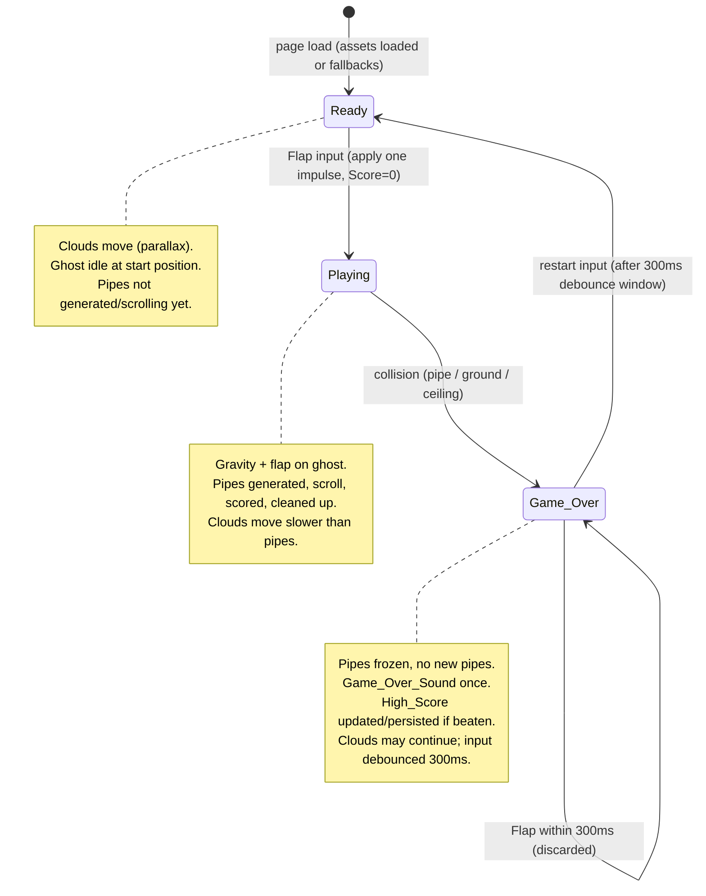

# Design Document

## Overview

Flappy Kiro is a browser-based, retro endless side-scroller. A white ghost falls under
constant gravity, and the player flaps it upward (spacebar, mouse click, or touch) to steer
through gaps in scrolling green pipes. One point is earned per Pipe_Pair passed. A collision
with a pipe, the Ground, or the Ceiling ends the game. The High_Score persists across sessions
in browser local storage.

This design favors a **dependency-light vanilla stack**: a single `index.html`, one `style.css`,
and ES modules of plain JavaScript rendered onto an **HTML5 Canvas 2D** context. The game runs by
opening `index.html` in any modern browser — no build step, bundler, package manager, or framework.

### Why this approach

- **Zero tooling.** The workspace is a bare directory (assets, README, `.gitignore`). The game must
  load and render within 3 seconds of page load (Req 1.1); a static page with no bundle startup is the
  simplest way to meet that reliably.
- **Canvas 2D over DOM.** The game needs per-frame animation of pipes, clouds, and the ghost with
  parallax layering and pixel-level bounding-box collision. Canvas gives direct, predictable control
  over the draw order and is well-suited to a fixed-size play area.
- **ES modules for testability.** The physics, scoring, pipe generation, collision, clamping, and
  high-score logic are extracted into **pure, side-effect-free functions** in modules that import
  nothing from the DOM. This lets property-based tests run under Node (or a headless runner) against
  the game logic while rendering and audio stay isolated behind thin adapters.

### Key design decisions

| Decision | Rationale |
| --- | --- |
| Fixed-size logical play area (e.g. 480×640 or 800×600) with canvas scaled to fit | Deterministic physics and collision; the reference UI is landscape (~809×655), so the canvas uses a fixed logical resolution and CSS scales it. |
| Fixed-timestep simulation with an accumulator; variable-rate rendering | Deterministic, frame-rate-independent physics (Req 2, 3, 5). Decoupling update from render keeps collision/scoring reproducible for property tests. |
| Pure logic modules + thin render/audio/storage adapters | Enables property-based testing of all testable acceptance criteria without a browser. |
| Fallbacks for every external asset (sprite, sounds) | Reqs 1.4, 2.6, 5.7, 9.9 require the game to keep running when an asset fails. |
| Single central config module (`config.js`) as the one source of truth for all tunable values | ALL tunable constants and parameters — physics (gravity, flap velocity), pipe geometry/speed, cloud behavior, scoring, display fonts/colors, storage key, debounce timing, play-area dimensions, and fallback colors — live in one place so they can be changed in a single file. No other module hardcodes these values; every module imports from config. This keeps tuning centralized and prevents the same constant drifting out of sync across modules. |

## Architecture

The game is organized into a **pure simulation core** and a set of **adapters** that touch the
browser (canvas, audio, storage, input). The game loop drives the core with a fixed timestep and
renders the resulting state.

```mermaid
graph TD
    subgraph Browser Adapters
        INPUT[InputController<br/>keyboard / mouse / touch]
        AUDIO[AudioManager<br/>jump + game over]
        STORE[HighScoreStore<br/>localStorage]
        RENDER[Renderer<br/>Canvas 2D]
        ASSETS[AssetLoader<br/>sprite + sounds]
    end

    subgraph Simulation Core (pure logic)
        STATE[GameState model]
        PHYS[physics<br/>gravity, flap]
        PIPES[pipes<br/>generate, scroll, clamp, cleanup]
        SCORE[scoring<br/>pass detection]
        COLL[collision<br/>AABB vs pipe/ground/ceiling]
        CLOUD[clouds<br/>parallax move + wrap]
        HS[highscore<br/>validate, update]
    end

    LOOP[GameLoop<br/>fixed-step accumulator]

    INPUT -->|flap / restart intents| LOOP
    LOOP --> PHYS
    LOOP --> PIPES
    LOOP --> SCORE
    LOOP --> COLL
    LOOP --> CLOUD
    LOOP --> HS
    PHYS --> STATE
    PIPES --> STATE
    SCORE --> STATE
    COLL --> STATE
    CLOUD --> STATE
    HS --> STATE
    LOOP -->|on flap| AUDIO
    LOOP -->|on game over| AUDIO
    HS --> STORE
    STORE -->|load on boot| HS
    ASSETS --> RENDER
    STATE --> RENDER
```

### Game loop (fixed timestep)

The loop uses `requestAnimationFrame` for rendering and a fixed-timestep accumulator for simulation,
so physics, scrolling, scoring, and collision are deterministic and frame-rate independent.

```mermaid
flowchart TD
    RAF[requestAnimationFrame tick] --> DT[compute real delta, clamp to max<br/>e.g. 250ms to avoid spiral of death]
    DT --> ACC[accumulator += delta]
    ACC --> CHECK{accumulator >= FIXED_DT?}
    CHECK -->|yes| STEP[simulate one fixed step<br/>FIXED_DT = 1/60 s]
    STEP --> ACC2[accumulator -= FIXED_DT]
    ACC2 --> CHECK
    CHECK -->|no| DRAW[render current state<br/>interpolation optional]
    DRAW --> RAF
```



- `FIXED_DT` is `1/60` second. Each simulation step advances physics, pipe positions, cloud positions,
  scoring, and collision checks by exactly `FIXED_DT`.
- The real frame delta is **clamped** (e.g. to 250 ms) before accumulating, preventing a long pause
  (tab backgrounded) from fast-forwarding the simulation.
- Rendering happens once per animation frame using the latest simulated state.

### State machine



Behavior per state:

- **Ready** — Score is 0 and displayed (Req 1.2). Clouds move with parallax (Req 9.3). Ghost sits at its
  start position; no pipes scroll or generate. The first Flap transitions to Playing and applies one
  impulse (Req 2.7).
- **Playing** — Gravity applies each step; Flap sets a fixed upward velocity (Req 2). Pipes generate,
  scroll, score, and are cleaned up (Req 3, 4). Collision is checked each step (Req 5). Clouds move
  slower than pipes (Req 9.4).
- **Game_Over** — Pipe movement and generation stop within one frame (Req 5.5, 5.6). Game_Over_Sound
  plays once (Req 5.4). If Score beats High_Score, High_Score updates and persists (Req 6). A Flap within
  300 ms of entering Game_Over is discarded (Req 8.6); a Flap after the window restarts to Ready (Req 8).

## Components and Interfaces

All simulation-core functions are **pure**: they take the current state (and inputs) and return new or
mutated state without touching the DOM, timers, audio, or storage. Adapters are the only components that
perform I/O.

### Config (`config.js`)

The single source of truth for every tunable constant and parameter. Exports a single **frozen**
(`Object.freeze`) default `Config` object (see Data Models) so no module can mutate it, grouped into
labeled sections and documented with the unit and the requirement-mandated valid range of each value:

- **playArea** — logical pixel dimensions of the play field (`width`, `height`).
- **physics** — `gravity` (px/s², downward) and `flapVelocity` (px/s, fixed upward impulse; negative).
- **pipes** — `speed` (px/s, within `[100, 300]`, Req 3.1), `width` (px), `gap` min/max (px, within
  `[100, 200]`, Req 3.2), `spacing` min/max (px, within `[150, 400]`, Req 3.3), `ceilingMargin` and
  `groundMargin` (px, each `>= 50`, Req 3.5).
- **clouds** — `speeds` (px/s; at least two distinct, each strictly less than `pipes.speed`, Req 9.3, 9.4)
  and `count` min/max (within `[1, 5]`, Req 9.1).
- **scoring** — scoring-related constants (starting score, score increment).
- **display** — fonts and colors for rendered text (e.g. the white Score_Display color, Req 9.8).
- **fallbackColors** — solid fallback fills approximating failed assets: sky blue, pipe green, and the
  ghost placeholder color (Req 1.4, 9.9).
- **storage** — the local-storage `key` for the persisted High_Score.
- **timing** — `restartDebounceMs` (ms, Req 8.6).

Every value documents its unit and, where the requirements mandate one, its valid range.

- `loadConfig(overrides): Config` — a **pure boundary function** that produces an *effective* config by
  merging optional `overrides` (for example, values parsed from URL query parameters) onto the frozen
  defaults, then **validating and clamping** every value to its requirement-mandated range. It returns a
  **new** validated object and never mutates the frozen default. Clamping rules, consistent with the
  design's existing clamping philosophy (see `clampGapTop`):
  - pipe speed clamped to `[100, 300]` (Req 3.1),
  - gap height min/max clamped to `[100, 200]` (Req 3.2),
  - spacing min/max clamped to `[150, 400]` (Req 3.3),
  - ceiling/ground margins clamped to `>= 50` (Req 3.5),
  - every cloud speed clamped to be strictly less than the (already-clamped) pipe speed, and at least two
    distinct cloud speeds are preserved (Req 9.3, 9.4),
  - cloud count min/max clamped to `[1, 5]` (Req 9.1),
  - high-score maximum clamped to `999999` (Req 6.1).

  Out-of-range numeric overrides are clamped to the nearest valid value; non-numeric or malformed
  overrides are ignored and the default is retained. `loadConfig` lives at the config boundary; the
  simulation core always receives the already-validated effective config, so no core function has to
  re-check ranges.

### GameLoop (`loop.js`)

Owns the `requestAnimationFrame` cycle and the fixed-timestep accumulator. Collects input intents from
`InputController`, calls `simulateStep(state, intent, FIXED_DT, config, rng)` for each fixed step, fires
audio side effects on edges (flap applied, entered Game_Over), and calls `Renderer.draw(state)` once per
frame.

- `start(): void` — begins the RAF loop.
- `simulateStep(state, intent, dt, config, rng): GameState` — advances one fixed step. Delegates to the
  pure modules below. Returns the next state. Also returns/collects side-effect flags (e.g.
  `flapApplied`, `enteredGameOver`) the loop uses to trigger audio.

### physics (`physics.js`) — pure

- `applyGravity(ghost, gravity, dt): Ghost` — returns the ghost with `vy += gravity*dt` and `y += vy*dt`.
- `applyFlap(ghost, flapVelocity): Ghost` — returns the ghost with `vy = flapVelocity` (a fixed upward,
  i.e. negative, value). Same value for keyboard/mouse/touch (Req 2.2–2.4).

### pipes (`pipes.js`) — pure

- `generatePipePair(x, config, rng): PipePair` — chooses a Gap height in `[GAP_MIN, GAP_MAX]` and a Gap
  top position, then **clamps** the Gap so its top is ≥ `CEILING_MARGIN` (50px) from the Ceiling and its
  bottom is ≥ `GROUND_MARGIN` (50px) from the Ground (Req 3.2, 3.5, 3.6). The pair is always kept.
- `scrollPipes(pipes, speed, dt): PipePair[]` — moves each pair left by `speed*dt` (Req 3.1).
- `cullOffscreen(pipes, playArea): PipePair[]` — removes pairs whose right edge < 0 (Req 3.4).
- `maybeSpawn(pipes, config, rng, playArea): PipePair[]` — appends a new pair at the right edge when the
  last pair is ≥ `spacing` from the right edge (Req 3.3), where `spacing ∈ [150, 400]`.
- `clampGapTop(gapTop, gapHeight, config): number` — the pure clamping helper used by `generatePipePair`,
  exposed for direct testing (Req 3.6).

### scoring (`scoring.js`) — pure

- `updateScore(state): { score, pipes }` — for each pair not yet marked `passed` whose trailing Gap edge
  is now left of the Ghost's x, and which the Ghost did not collide with, mark it `passed` and increment
  Score by one (Req 4.2, 4.3). Idempotent per pair via the `passed` flag.

### collision (`collision.js`) — pure

- `aabbOverlap(a, b): boolean` — axis-aligned bounding-box overlap test.
- `ghostHitsPipe(ghost, pipes): boolean` — true if the Ghost box overlaps any top or bottom pipe box
  (Req 5.1).
- `ghostHitsBounds(ghost, playArea): boolean` — true if the Ghost box overlaps the Ground (Req 5.2) or
  reaches/exceeds the Ceiling (Req 5.3).

### clouds (`clouds.js`) — pure

- `moveClouds(clouds, dt): Cloud[]` — moves each Cloud left by its own `speed*dt`. Clouds carry at least
  two distinct speeds (Req 9.3), each slower than pipe speed (Req 9.4).
- `wrapClouds(clouds, playArea, rng): Cloud[]` — when a Cloud's right edge passes the left edge, reposition
  it beyond the right edge (Req 9.5), keeping 1–5 clouds present (Req 9.1).

### highscore (`highscore.js`) — pure

- `parseHighScore(raw): number` — returns the integer if `raw` is a valid integer in `[0, 999999]`,
  otherwise `0` (Req 6.4, 6.5).
- `nextHighScore(score, highScore): number` — returns `max(score, highScore)`, clamped to `[0, 999999]`
  (Req 6.1). Never decreases.

### Adapters (I/O boundary)

- **InputController (`input.js`)** — binds `keydown` (Space), `mousedown` (primary button in play area),
  and `touchstart` (tap in play area). Normalizes all three into a single `FLAP` intent (Req 2.2–2.4,
  2.7, 8.1). Emits intents to the loop; the loop decides meaning by Game_State.
- **AudioManager (`audio.js`)** — `playJump()` restarts `jump.wav` from the start if already playing,
  within 100 ms (Req 2.5); `playGameOver()` plays `game_over.wav` once per transition (Req 5.4). Both wrap
  playback in try/catch and swallow failures so gameplay never stalls (Req 2.6, 5.7).
- **HighScoreStore (`storage.js`)** — `load(): string | null` reads `localStorage`; `save(n): void` writes
  it, wrapped in try/catch so a storage failure retains the in-memory value and never interrupts play
  (Req 6.2, 6.3).
- **AssetLoader (`assets.js`)** — loads `ghosty.png`; on error reports a flag so the Renderer draws a
  placeholder ghost shape (Req 1.4) and the game still enters Ready. Also loads audio.
- **Renderer (`render.js`)** — draws, in order: blue sky, parallax semi-transparent rounded clouds, green
  pipes, dark ground strip, ghost sprite (or placeholder), and the white Score_Display. Uses fallback fill
  colors for any failed asset (green pipe, blue sky, placeholder ghost) (Req 9).

### Rendering order (per frame)

1. Blue sky fill across the full play area (Req 9.1; fallback blue, Req 9.9).
2. Clouds: 1–5 white rounded shapes, each with `0 < alpha < 1` (Req 9.1, 9.2), drawn back-to-front by layer.
3. Pipes: green fill for every visible pipe (Req 9.6; fallback green, Req 9.9).
4. Ground: dark strip spanning the full width along the bottom (Req 9.7).
5. Ghost: `ghosty.png` sprite, or placeholder shape if the sprite failed (Req 1.3, 1.4).
6. Score_Display: white text `"Score: N | High: M"` centered over the Ground (Req 7.1, 7.2, 9.8).

## Data Models

All models are plain JavaScript objects (no classes required). Coordinates are in logical play-area
pixels with the origin at the top-left; `y` increases downward, so `vy > 0` is downward and the flap sets
`vy` to a negative value.

The default `Config` is the single source of truth for every tunable value, grouped into labeled
sections. It is **frozen** with `Object.freeze` and treated as immutable; `loadConfig(overrides)` returns
a new validated object rather than mutating the default. Values are chosen within the ranges the
requirements allow.

```javascript
// Single source of truth for all constants/parameters. Frozen and immutable.
// loadConfig(overrides) returns a NEW validated/clamped object; it never mutates this default.
const Config = Object.freeze({
  // --- Play-area dimensions ---
  playArea:   { width: 480, height: 640 },  // logical px; canvas scaled to fit
  ground:     { height: 80 },               // px; dark strip along the bottom
  ceilingY:   0,                            // top boundary (y)

  // --- Physics ---
  physics: {
    gravity:      1600,                     // px/s^2 (downward)
    flapVelocity: -420,                     // px/s (fixed upward impulse; negative)
  },

  // --- Pipe geometry / speed ---
  pipes: {
    speed:         180,                     // px/s  (within [100, 300], Req 3.1)
    width:         60,                      // px
    gap:           { min: 100, max: 200 },  // px (within [100, 200], Req 3.2)
    spacing:       { min: 150, max: 400 },  // px (within [150, 400], Req 3.3)
    ceilingMargin: 50,                      // px (>= 50, Req 3.5)
    groundMargin:  50,                      // px (>= 50, Req 3.5)
  },

  // --- Cloud behavior ---
  clouds: {
    speeds: [40, 70],                       // px/s; >=2 distinct, each < pipes.speed (Req 9.3, 9.4)
    count:  { min: 1, max: 5 },             // within [1, 5] (Req 9.1)
  },

  // --- Scoring ---
  scoring: {
    start:     0,                           // Score at session start (Req 4.1)
    increment: 1,                           // points per passed Pipe_Pair (Req 4.2)
  },

  // --- Display (fonts / colors) ---
  display: {
    scoreFont:  '16px monospace',
    scoreColor: '#ffffff',                  // white Score_Display text (Req 9.8)
    groundColor:'#4a3b2a',                  // dark ground strip (Req 9.7)
  },

  // --- Fallback fill colors for failed assets (Req 1.4, 9.9) ---
  fallbackColors: {
    sky:            '#87ceeb',              // sky blue
    pipe:           '#2e8b2e',              // pipe green
    ghostPlaceholder:'#ffffff',             // white ghost placeholder
  },

  // --- Storage ---
  storage: {
    key: 'flappyKiro.highScore',            // localStorage key
  },

  // --- Timing ---
  timing: {
    restartDebounceMs: 300,                 // ms (Req 8.6)
  },

  // --- Bounds ---
  highScoreMax: 999999,                     // Req 6.1
});

// The player ghost.
const Ghost = {
  x: 0, y: 0,          // top-left of bounding box
  width: 34, height: 24,
  vy: 0,               // vertical velocity (px/s)
};

// One pair of pipes with the gap between them.
const PipePair = {
  x: 0,                // left edge; moves leftward over time
  width: 60,
  gapTop: 0,           // y of the top edge of the gap (bottom of the top pipe)
  gapHeight: 0,        // vertical opening (within clamped range)
  passed: false,       // true once scored, prevents double counting (Req 4.2)
  collided: false,     // true if ghost hit this pair (blocks scoring, Req 4.3)
};

// A background parallax cloud.
const Cloud = {
  x: 0, y: 0,
  width: 0, height: 0,
  speed: 0,            // one of Config.clouds.speeds (distinct layers)
  alpha: 0,            // 0 < alpha < 1 (semi-transparent, Req 9.2)
};

// The complete game state the loop advances and the renderer draws.
const GameState = {
  mode: 'Ready',               // 'Ready' | 'Playing' | 'Game_Over'
  ghost: Ghost,
  pipes: [],                   // PipePair[]
  clouds: [],                  // Cloud[]
  score: 0,                    // non-negative integer (Req 4)
  highScore: 0,                // integer in [0, 999999] (Req 6)
  gameOverAtMs: null,          // timestamp of entering Game_Over (debounce, Req 8.6)
  gameOverSoundPlayed: false,  // ensures once-per-transition (Req 5.4)
  assets: { ghostLoaded: false },
};
```

### Gap placement and clamping

For a generated pair with chosen `gapHeight ∈ [gap.min, gap.max]`:

- Lowest valid `gapTop` = `ceilingY + ceilingMargin`.
- Highest valid `gapTop` = `playArea.height - ground.height - groundMargin - gapHeight`.
- `clampGapTop` clamps the randomly chosen `gapTop` into `[lowest, highest]` (Req 3.6). If the valid range
  is empty for a given `gapHeight`, the config ranges guarantee it is not: with `height 640`, `ground 80`,
  margins `50/50`, and max gap `200`, the window is `[50, 310]`, which is non-empty.

### Restart debounce model

`gameOverAtMs` records when Game_Over was entered. On a restart intent, the loop compares the current time
to `gameOverAtMs`: if `now - gameOverAtMs < restartDebounceMs` (300 ms), the intent is discarded with no
buffering (Req 8.6); otherwise the game resets (Score 0, pipes cleared, ghost repositioned, mode → Ready),
keeping High_Score (Req 8.2–8.5).

## Correctness Properties

*A property is a characteristic or behavior that should hold true across all valid executions of a
system — essentially, a formal statement about what the system should do. Properties serve as the bridge
between human-readable specifications and machine-verifiable correctness guarantees.*

The simulation core is a set of pure functions, which makes it well suited to property-based testing.
Rendering, audio, and storage I/O are verified separately with example and integration tests (see Testing
Strategy). The properties below were derived from the prework analysis and consolidated to remove
redundancy (e.g. the three collision boundaries combine into one collision property; the gap placement
and clamping criteria combine into one clamping property; the scoring and no-score-on-collision criteria
combine into one scoring property).

### Property 1: Gravity accelerates the ghost downward

*For any* ghost and any positive timestep `dt`, with no flap applied, `applyGravity` produces a new ghost
whose vertical velocity is strictly greater (more downward) than before and whose vertical position has
moved downward.

**Validates: Requirements 2.1**

### Property 2: Flap sets the same fixed upward velocity for every input source

*For any* ghost, applying a flap — whether originating from spacebar, mouse click, or touch tap — sets the
ghost's vertical velocity to exactly `Config.physics.flapVelocity` (a fixed upward value), independent of the
prior velocity and identical across all three input sources.

**Validates: Requirements 2.2, 2.3, 2.4**

### Property 3: A flap while Ready starts the game with a single impulse

*For any* Ready game state, handling one flap intent transitions the mode to Playing and sets the ghost's
vertical velocity to exactly `Config.physics.flapVelocity`, applying exactly one impulse.

**Validates: Requirements 2.7**

### Property 4: Pipes scroll left at constant speed

*For any* set of pipe pairs and any positive timestep `dt`, `scrollPipes` moves every pair's left edge
left by exactly `pipeSpeed * dt`, so each pair's x strictly decreases while Playing.

**Validates: Requirements 3.1**

### Property 5: Generated gaps are always within the clamped valid range

*For any* random source and any proposed gap position, a generated pipe pair has `gapHeight` within
`[gap.min, gap.max]`, has its gap top no closer than `ceilingMargin` to the Ceiling and its gap bottom no
closer than `groundMargin` to the Ground, and is always kept (never rejected or regenerated). Equivalently,
`clampGapTop` maps any proposed gap top into the valid window.

**Validates: Requirements 3.2, 3.5, 3.6**

### Property 6: Pipes spawn at valid spacing and at least one is always present during play

*For any* sequence of Playing simulation steps, each newly spawned pair is placed at a horizontal spacing
within `[spacing.min, spacing.max]` from the previous pair, and the set of pipe pairs is never empty
throughout the session.

**Validates: Requirements 3.3**

### Property 7: Offscreen pipes are culled

*For any* set of pipe pairs, after `cullOffscreen` no remaining pair has its right edge left of the play
area's left edge (`x + width < 0`).

**Validates: Requirements 3.4**

### Property 8: Scoring is monotonic and counts each uncollided pass exactly once

*For any* sequence of Playing simulation steps, the Score increases by exactly one for each pipe pair whose
trailing gap edge passes the ghost's x position without the ghost having collided with that pair, is never
incremented for a pair marked collided, and never decreases.

**Validates: Requirements 4.2, 4.3**

### Property 9: Collision is detected exactly on bounding-box overlap or boundary contact

*For any* ghost and set of pipes within the play area, a collision is reported if and only if the ghost's
bounding box overlaps any pipe's bounding box, overlaps the Ground boundary, or the ghost's position
reaches or exceeds the Ceiling boundary; when a collision is reported during Playing, the next simulation
step sets the mode to Game_Over.

**Validates: Requirements 5.1, 5.2, 5.3**

### Property 10: Pipes are frozen while in Game_Over

*For any* Game_Over game state, a simulation step leaves every pipe pair's position unchanged and does not
increase the number of pipe pairs.

**Validates: Requirements 5.5, 5.6**

### Property 11: High score equals the clamped maximum and never decreases

*For any* current Score and stored High_Score, `nextHighScore` returns `max(Score, High_Score)` clamped to
`[0, 999999]`, which is always greater than or equal to the prior High_Score.

**Validates: Requirements 6.1**

### Property 12: High-score parsing accepts valid integers and rejects everything else

*For any* integer `n` in `[0, 999999]`, parsing its string form returns `n`; *for any* input that is
missing, non-numeric, or outside `[0, 999999]`, parsing returns `0`.

**Validates: Requirements 6.4, 6.5**

### Property 13: Score display is formatted exactly as specified

*For any* non-negative integers N and M, `formatScoreDisplay(N, M)` returns the string
`"Score: N | High: M"` with N and M rendered as base-10 integers with no leading zeros.

**Validates: Requirements 7.1**

### Property 14: A flap within the debounce window is discarded without buffering

*For any* Game_Over game state in which less than `restartDebounceMs` (300 ms) has elapsed since entering
Game_Over, handling a flap intent leaves the mode as Game_Over and stores no buffered input, so the
discarded input cannot later trigger a restart on its own.

**Validates: Requirements 8.6**

### Property 15: A valid restart resets the session and preserves the high score

*For any* Game_Over game state in which at least `restartDebounceMs` has elapsed, handling a flap intent
resets the Score to zero, removes all pipe pairs, repositions the ghost to its start location, transitions
the mode to Ready, and leaves the High_Score unchanged.

**Validates: Requirements 8.1, 8.2, 8.3, 8.4, 8.5**

### Property 16: Clouds stay semi-transparent, bounded in count, and slower than pipes

*For any* game state, the number of clouds is within `[cloudCount.min, cloudCount.max]` (1 to 5), every
cloud's opacity satisfies `0 < alpha < 1`, and every cloud's speed is strictly less than `pipeSpeed`.

**Validates: Requirements 9.1, 9.2, 9.4**

### Property 17: Clouds move with parallax and wrap to stay continuously present

*For any* clouds in the Ready or Playing state and any positive `dt`, `moveClouds` decreases each cloud's x,
the clouds carry at least two distinct speeds (parallax), and after `wrapClouds` any cloud that passed the
left edge is repositioned beyond the right edge while the total cloud count is preserved.

**Validates: Requirements 9.3, 9.5**

### Property 18: Effective config always satisfies requirement ranges

*For any* override input — including out-of-range, non-numeric, or otherwise malformed values —
`loadConfig(overrides)` returns an effective config in which every value lies within its
requirement-mandated range: pipe speed is in `[100, 300]`, gap height min and max are in `[100, 200]`,
spacing min and max are in `[150, 400]`, the ceiling and ground margins are each `>= 50`, every cloud
speed is strictly less than the pipe speed, at least two distinct cloud speeds are present, the cloud
count min and max are in `[1, 5]`, and the high-score maximum is `999999`.

**Validates: Requirements 3.1, 3.2, 3.3, 3.5, 9.1, 9.4, 6.1**

## Error Handling

Every external dependency can fail, and the requirements mandate the game keeps running. Each failure is
contained at its adapter boundary and never propagates into the simulation core.

| Failure | Handling | Requirement |
| --- | --- | --- |
| `ghosty.png` fails to load | `AssetLoader` sets `ghostLoaded = false`; the game still enters Ready; the Renderer draws a placeholder ghost shape instead of the sprite. | 1.4, 9.9 |
| `jump.wav` cannot play on flap | `AudioManager.playJump` wraps playback in try/catch and swallows the error; the flap impulse and all gameplay continue. | 2.6 |
| `game_over.wav` fails to load or play | `AudioManager.playGameOver` wraps playback in try/catch; the Game_Over transition completes without sound and the game keeps running. | 5.7 |
| `localStorage.setItem` throws (quota/disabled) | `HighScoreStore.save` catches the error; the in-memory High_Score is retained and play continues uninterrupted. | 6.3 |
| Persisted High_Score missing / non-numeric / out of `[0, 999999]` | `parseHighScore` returns `0`. | 6.5 |
| High_Score cannot be read at display time | The Score_Display shows `High: 0` and continues to show the current Score. | 7.4 |
| Any required visual asset fails | The Renderer uses solid fallback fills approximating the asset — blue sky, green pipes, placeholder ghost — and keeps rendering all other elements. | 9.9 |
| Long frame delta (tab backgrounded) | The game loop clamps the real delta before accumulating, preventing a simulation fast-forward / spiral of death. | derived (loop stability) |
| Empty valid gap range for a chosen gap height | Config ranges guarantee a non-empty window; `clampGapTop` clamps rather than throwing. | 3.6 |

## Testing Strategy

The game splits cleanly into a **pure simulation core** and **I/O adapters**, so the strategy pairs
property-based tests over the core with example and integration tests over the adapters.

### Property-based testing

- **Library:** [fast-check](https://github.com/dubzzz/fast-check) with a test runner such as Vitest or
  Jest. fast-check is the standard property-based testing library for JavaScript/TypeScript; it is not
  implemented from scratch.
- **Scope:** Properties 1–18 above, each implemented as a **single** property-based test over the pure
  functions in `physics.js`, `pipes.js`, `scoring.js`, `collision.js`, `clouds.js`, `highscore.js`,
  `config.js` (`loadConfig`), and the display formatter. Config loading/validation (`loadConfig`) is a
  pure function whose output varies with arbitrary override input, so it is property-tested (Property 18,
  min 100 iterations, tagged **Feature: flappy-kiro, Property 18**) to confirm every effective value
  stays within its requirement-mandated range. Reading URL query parameters into an overrides object is a
  thin I/O boundary that does not vary meaningfully with generated input and is covered by a small
  example test instead.
- **Iterations:** Each property test runs a **minimum of 100 iterations** (`fc.assert(..., { numRuns: 100 })`).
- **Determinism:** The simulation accepts an injected `rng` (seeded) so pipe/cloud generation is
  reproducible; fast-check supplies the generated inputs and seeds.
- **Tagging:** Each property test includes a comment referencing its design property in the format
  **Feature: flappy-kiro, Property {number}: {property_text}**.

### Example-based unit tests

For concrete scenarios and failure branches that are not universal:

- Initial boot state is Ready with Score 0 (1.2).
- Sprite-load-failure path draws a placeholder and still reaches Ready (1.4).
- Jump sound throwing on play does not block the flap (2.6).
- Starting a session sets Score to 0 (4.1).
- Game_Over sets `gameOverSoundPlayed` and calls `playGameOver` once; later frames do not replay (5.4).
- Game_Over sound throwing still completes the transition (5.7).
- `localStorage` write throwing retains the in-memory High_Score (6.3).
- Unreadable High_Score renders `High: 0` with the current Score (7.4).
- Each visual fallback path (sky, pipe, ghost placeholder) renders without interruption (9.9).
- Reading URL query parameters produces an overrides object that `loadConfig` then validates (config boundary).

### Integration / render tests

Using a mock or headless canvas (e.g. jsdom plus a stubbed 2D context) and mock audio/storage:

- The canvas renders sky, ground, ghost, and Score_Display on boot (1.1 smoke test).
- The ghost sprite is drawn via `drawImage` when loaded (1.3).
- Jump sound resets `currentTime` to 0 and calls `play()` on flap (2.5).
- Score_Display reflects state each frame (4.5, 7.3).
- `save` is called with the new High_Score when it increases (6.2).
- Score text stays within the play-area bounds for boundary values 0 and 9999 (7.2).
- Pipes are filled green (9.6), the ground is a dark full-width bottom strip (9.7), and the score text is
  white (9.8).

### Why not property tests everywhere

Rendering (fill colors, sprite draws, text layout), audio playback timing, and storage persistence are
I/O against browser APIs whose behavior does not vary meaningfully with generated input; running them 100×
would not surface additional bugs. They are covered by targeted example and integration tests instead,
following the decision guide (test your code's logic vs. external services; does behavior vary with input).

## Requirements Traceability

| Requirement | Covered by |
| --- | --- |
| 1.1 Render within 3s | Loop + Renderer (static page); smoke test |
| 1.2 Ready + Score 0 on load | Initial `GameState`; example test |
| 1.3 Ghost from sprite | Renderer / AssetLoader; integration test |
| 1.4 Sprite fallback placeholder | AssetLoader + Renderer; example test; Error Handling |
| 2.1 Gravity | `physics.applyGravity`; Property 1 |
| 2.2–2.4 Flap impulse (key/mouse/touch) | `physics.applyFlap` + InputController; Property 2 |
| 2.5 Jump sound ≤100ms, restart | AudioManager; integration test |
| 2.6 Jump sound failure tolerated | AudioManager; example test; Error Handling |
| 2.7 Flap in Ready → Playing + impulse | `simulateStep`; Property 3 |
| 3.1 Pipe scroll speed | `pipes.scrollPipes`; Property 4 |
| 3.2 Gap height range | `pipes.generatePipePair`; Property 5 |
| 3.3 Spacing + always-present | `pipes.maybeSpawn`; Property 6 |
| 3.4 Offscreen cull | `pipes.cullOffscreen`; Property 7 |
| 3.5 Gap margins | `pipes.clampGapTop`; Property 5 |
| 3.6 Clamp, keep pair | `pipes.clampGapTop`; Property 5; Error Handling |
| 4.1 Score 0 at start | `simulateStep`; example test |
| 4.2 Pass → +1 | `scoring.updateScore`; Property 8 |
| 4.3 No score on collision | `scoring.updateScore`; Property 8 |
| 4.4 Render score integer centered | Renderer; example/integration test |
| 4.5 Update ≤100ms | Renderer per frame; integration test |
| 5.1 Pipe collision → Game_Over | `collision.ghostHitsPipe`; Property 9 |
| 5.2 Ground collision → Game_Over | `collision.ghostHitsBounds`; Property 9 |
| 5.3 Ceiling → Game_Over | `collision.ghostHitsBounds`; Property 9 |
| 5.4 Game_Over sound once | AudioManager + flag; example test |
| 5.5 Stop pipe movement | `simulateStep` (Game_Over); Property 10 |
| 5.6 Halt pipe generation | `simulateStep` (Game_Over); Property 10 |
| 5.7 Game_Over sound failure tolerated | AudioManager; example test; Error Handling |
| 6.1 High_Score = max, in range | `highscore.nextHighScore`; Property 11 |
| 6.2 Persist on change | HighScoreStore; integration test |
| 6.3 Persist failure tolerated | HighScoreStore; example test; Error Handling |
| 6.4 Load valid persisted | `highscore.parseHighScore`; Property 12 |
| 6.5 Invalid → 0 | `highscore.parseHighScore`; Property 12; Error Handling |
| 6.6 Render High_Score | Renderer; example test |
| 7.1 Display format | `formatScoreDisplay`; Property 13 |
| 7.2 Centered, fits 0..9999 | Renderer; integration test |
| 7.3 Update ≤100ms | Renderer per frame; integration test |
| 7.4 High_Score unavailable → 0 | `formatScoreDisplay`/parse; example test; Error Handling |
| 8.1 Flap restarts in Game_Over | `simulateStep`; Property 15 |
| 8.2 Reset Score | `simulateStep`; Property 15 |
| 8.3 Remove pipes | `simulateStep`; Property 15 |
| 8.4 Reposition ghost → Ready | `simulateStep`; Property 15 |
| 8.5 Retain High_Score | `simulateStep`; Property 15 |
| 8.6 300ms debounce discard | `simulateStep`; Property 14 |
| 9.1 Sky + 1–5 clouds | Renderer + `clouds`; Property 16 |
| 9.2 Semi-transparent clouds | `clouds`; Property 16 |
| 9.3 Parallax ≥2 speeds | `clouds.moveClouds`; Property 17 |
| 9.4 Clouds slower than pipes | `config.js` + `clouds`; Property 16; config ranges via Property 18 |
| 9.5 Cloud wrap | `clouds.wrapClouds`; Property 17 |
| 9.6 Green pipes | Renderer; integration test |
| 9.7 Dark ground strip | Renderer; integration test |
| 9.8 White score text | Renderer; integration test |
| 9.9 Visual asset fallbacks | Renderer + AssetLoader (`config.fallbackColors`); example tests; Error Handling |
| Config validation / clamping (effective config within ranges) | `config.js` `loadConfig`; Property 18 (Reqs 3.1, 3.2, 3.3, 3.5, 9.1, 9.4, 6.1) |
